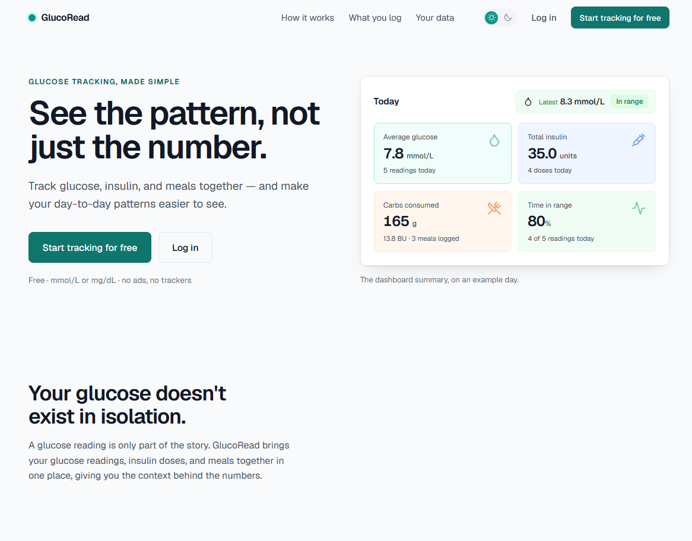
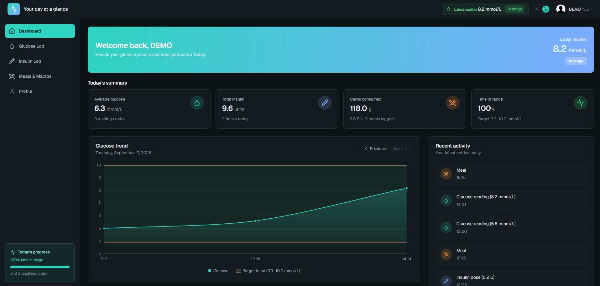
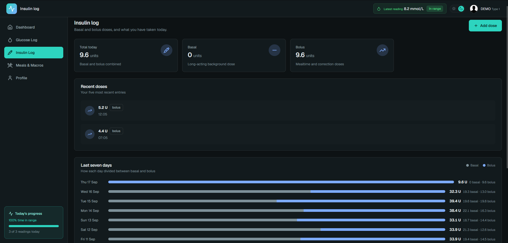
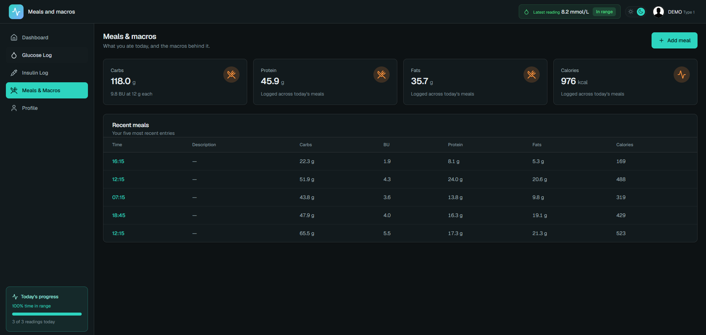
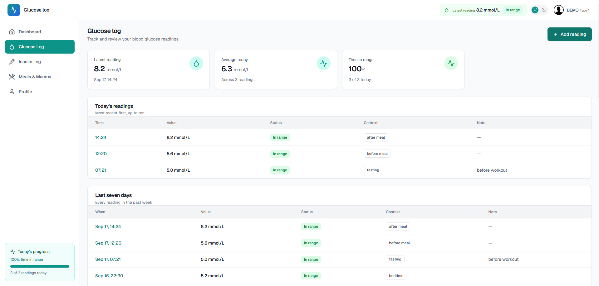

# GlucoRead

Glucose, insulin and meal tracking for people managing diabetes day to day, with a
dashboard that turns raw logs into a picture of the day.

**Live:** [glucoread.com](https://glucoread.com)
&nbsp;·&nbsp;
[](https://github.com/vedranchi/glucoread/actions/workflows/ci.yml)



## Features

- Glucose, insulin and meal logging with per-user history and full edit/delete
- Dashboard with daily totals, recent activity and a day-by-day glucose trend
- mmol/L or mg/dL display, per user, without touching stored data
- Email-based auth: signup, sign-in, password reset — no username
- Soft deletes: log entries are archived, never destroyed
- Light and dark themes on one shared token layer; responsive down to phone width



| Insulin | Meals | Glucose
|---|---|
|  |  |  |

## Stack

| Layer | Choice |
|---|---|
| Backend | Python 3.13, Django 5.2 |
| Database | PostgreSQL 17 |
| Frontend | Server-rendered Django templates — no client-side framework |
| Static files | WhiteNoise |
| Email | Env-driven SMTP |
| Deployment | Docker, gunicorn, Caddy (reverse proxy + automatic TLS) |
| Hosting | Oracle Cloud Always Free VM |
| CI/CD | GitHub Actions → GHCR image → systemd timer pulls on the VM |
| Backups | Nightly verified Postgres dumps, synced to Backblaze B2 |

## Architecture

| App | Responsibility |
|---|---|
| `users` | Custom email-login `User`, `UserPreferences`, `HealthProfile`, auth, profile |
| `logs` | Core domain: `GlucoseLog`, `InsulinLog`, `MealLog` and their CRUD views |
| `dashboard` | Post-login summary screen and glucose chart |
| `main` | Shared base template, home routing, no-cache middleware |
| `landing` | Public marketing page |
| `core` | Settings, URLs, WSGI |

## Design decisions

Health data imposes constraints a CRUD app doesn't, and these are enforced across the
codebase rather than per view:

- **Glucose is stored only in mmol/L**, at three decimal places so the mg/dL round-trip is
  lossless. Conversion happens at the display edge, driven by a per-user preference, so unit
  choice can't corrupt stored data.
- **Soft deletes**, with `is_deleted=False` applied at every read path. Medical history isn't
  destroyed by a misclick.
- **Per-user scoping** on every query, backed by an isolation suite that asserts 404 rather
  than 403 — a 403 would confirm another user's record exists.
- **No PHI in logs.** Glucose values and identity are kept out of `__str__` and log output;
  `django.db.backends` is pinned above DEBUG so query parameters never leak.
- **Rate limiting** on sign-in, registration, password reset and the Django admin, by IP and
  by submitted credential.
- **Verified backups.** Each dump is checked for gzip integrity, a completion marker and its
  expected tables *before* rotation, then pushed off-site.

## Running locally

Requires Python 3.13+ and Docker.

```bash
git clone https://github.com/vedranchi/glucoread.git
cd glucoread

python3 -m venv env
./env/bin/pip install -r requirements.txt

cp .env.example .env
./env/bin/python -c "from django.core.management.utils import get_random_secret_key as k; print(k())" | sed 's/\$/\$\$/g'
# paste into SECRET_KEY — the sed doubles any `$`, see the note below

docker compose up -d db            # Postgres on 127.0.0.1:5433
./env/bin/python manage.py migrate
./env/bin/python manage.py runserver
```

`SECRET_KEY` and `DATABASE_URL` fail fast with no fallback, so the config step isn't
optional. Docker Compose interpolates `.env`, so a literal `$` in a value silently truncates
it — double each one to `$$`.

Seed two weeks of history to see the dashboard populated:

```bash
./env/bin/python manage.py seed_demo_data --reset
```

Signs in as `demo@glucoread.app` / `Demo1234!`. Refuses to run unless `DEBUG=True`.

## Testing

```bash
docker compose up -d db
./env/bin/python manage.py collectstatic --noinput
./env/bin/python manage.py test
```

`collectstatic` is required on a fresh clone: the test runner forces `DEBUG=False`, which
switches WhiteNoise to manifest storage, and without a built manifest every ``
tag raises. CI runs the same suite against a real Postgres service container.

## Deployment

Merging to `dev` ships. Actions runs the suite, builds the image and pushes it to GHCR; a
systemd timer on the VM pulls and restarts only when the image digest changes — the VM never
builds. Tagging `v*` publishes a versioned image without moving the tag production follows.
See [`deploy/README.md`](deploy/README.md) for the VM runbook.

## Known limitations

- `TIME_ZONE` is fixed to `Europe/Skopje`, so "today" rolls over at the wrong hour elsewhere
- Log entries are timestamped "now" with no way to edit the time, so readings can't be back-filled
- Soft deletes have no restore UI
- Email changes aren't verified
- crispy-forms and a Bootstrap 4 stylesheet are still loaded but render nothing (queued for removal)
- HSTS is at 7 days pending a full renewal cycle on the new domain

## How this was built

A large share of the code was generated with Claude Code. The domain rules it has to work
within — mmol/L storage, soft-delete filtering, per-user scoping, no PHI in logs — are
written down in [`CLAUDE.md`](CLAUDE.md) and enforced by the test suite, so a generated
change is held to the same line as a hand-written one. The architecture and the decisions
about what ships are not generated.

## License

[MIT](LICENSE) © Vedran Chichov

GlucoRead is a personal project for tracking your own readings. It is not a medical device,
it gives no clinical advice, and nothing it displays should be used to make treatment
decisions — talk to your care team instead.
